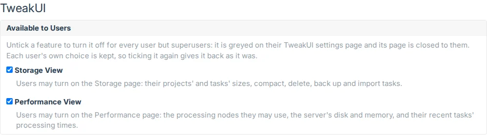
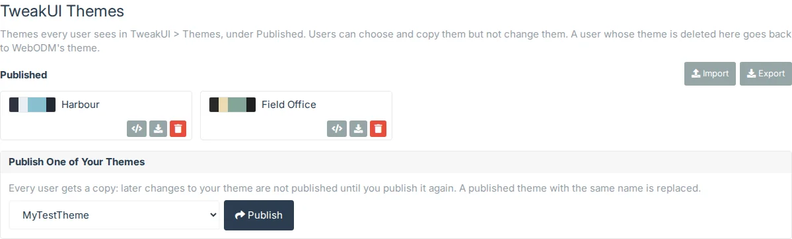

# Administration

## Administration > TweakUI

Superusers choose here which of TweakUI's features users may have and which themes every user is given. TweakUI
adds the link after Administration > Theme in the side menu. Other staff don't see it, and the page and its API refuse
them. The page has two sections: [Available to Users](#available-to-users) and
[Published Themes](#published-themes).

### Available to Users

**Available to Users** has a checkbox for each feature an administrator may withhold: **Tile Cache** (2D Map),
**Storage View** and **Performance View**. All are ticked when TweakUI is installed, so users have them unless a superuser unticks them.
Each change is saved at once.

When a feature is unticked, for every user but superusers (staff included):

- In TweakUI's settings, its setting is greyed with **Turned off by your administrator**, and can't be turned on.
- Its item in the side menu goes, and its page says it is turned off by your administrator.
- Its part of TweakUI's API refuses them.

Each user's own choice is kept. Ticking the feature again gives it back to everyone who had it on, as it was.
Superusers always keep these features.

### Published Themes

[Themes](themes#published-themes) every user sees in their TweakUI settings, under Themes > Published, to choose or
copy but not change. A user whose published theme is deleted goes back to WebODM's theme.

- **Publish One of Your Themes**: choose one of your own themes (make it in Settings > Themes > My Themes) and
  **Publish**. Every user gets a copy, so later changes to your theme aren't published until you publish it again. A
  published theme with the same name is replaced, and users who chose it keep it.
- **Import** adds a file or pasted JSON to the published themes, as under
  [Import and export](themes#import-and-export). A theme with the same name as a published one replaces it.
- **Export** downloads all the published themes as `tweakui-published-themes.json`; each theme's download button
  downloads just it, and **Copy JSON** puts it on the clipboard.
- **Delete** deletes a published theme, after asking.

There can be up to 50 published themes. In TweakUI 1.0.0 this was a page of its own, Administration > TweakUI Themes;
its address now opens this section.
