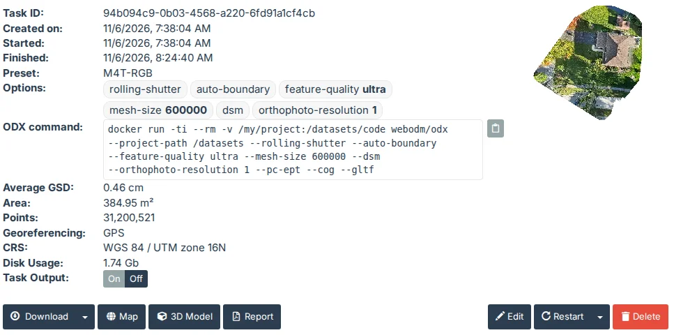
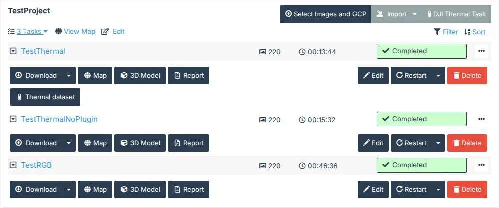

# General

## Task Options > Show Modified Options

Off by default.

In the Task Options dialog (a new task's Options > Edit, or a task's Edit), each group heading shows how many of
its options are not at ODM's default, out of how many it has: "Input & Preprocessing (1/13)" once ignore-gsd is
enabled. The count follows your changes, including "Reset to default". A preset's own settings count too (the
Default preset sets auto-boundary and dsm). Only in the grouped view; "Other Options" is counted while it is open.

## Task Options > Expand Configured

Off by default.

In the Task Options dialog, a collapsed group still shows the options in it that are not at ODM's default, under
its heading: "Structure From Motion" shows feature-quality when it is set to ultra. They're WebODM's own controls,
so you can change one there, or reset it to its default, and it leaves the list. Opening a group shows all its
options as usual, and closing it shows only the configured ones again. It works with or without Show Modified
Options, which counts the same options. Only in the grouped view; "Other Options" shows nothing while it is closed.

The Expand/Collapse button (beside Search and the view switch) then goes through three steps: **Expand All**,
**Collapse All** (the configured options hidden too) and **Collapse All but Configured**, back where the dialog
opens. Its tooltip names the next step. When no option is configured it's WebODM's own Expand All and Collapse All.

## Task Details > Enhanced Task Details

Off by default.

When a task is opened on the Dashboard, its details show when it started and finished, its current step while it
runs, and three rows in place of WebODM's one-line Options. Each part has its own setting under Enhanced Task
Details (Task Start and End Time, Show Current Processing Stage, Show Configured Task Preset, Options as Bubbles,
Show ODX Command), all on; they are greyed out while Enhanced Task Details is off. With Options as Bubbles off,
WebODM's own Options line stays.

- **Started** and **Finished**, after "Created on", in your local time. WebODM keeps no start or end time, so
  they are worked out from what it has: Started is when the task was created, Finished that plus its processing
  time ("Running" while it runs). Created means when its upload began, and a restart counts the processing time
  again from the new run, so after a slow upload or a restart they are off by that much.
- **Current Step**, while the task runs: the ODM stage it is in, read from the task's console every 5 seconds
  while its details are open, e.g. "Current Step (8/13): Texturing". ODM runs 13 stages (12 with
  fast-orthophoto, fewer with end-with); "Starting" before the first, "Downloading results" once ODM is done and
  WebODM fetches the results.
- **Preset**: the preset the task's options match, found as WebODM's Edit dialog finds it (the first preset with
  exactly the same options and values), or "Custom". WebODM doesn't record a task's preset, so a preset edited
  since may no longer match.
- **Options**: each option in its own bubble, with its value.
- **ODX command**: the command to run the task yourself, with a copy button:
  `docker run -ti --rm -v /my/project:/datasets/code webodm/odx --project-path /datasets` followed by the task's
  options and the three the processing node adds by itself (`--pc-ept --cog --gltf`), as the node runs it.
  Replace `/my/project` with your folder, which holds the photos in `images/`; a task's boundary is read from
  `boundary.geojson` there.

## Task Details > Expand Task Controls

Off by default.

On the Dashboard, a minimized task still shows its buttons: Download, Map, 3D Model, Report, Edit, Restart, Delete and
those other plugins add (such as Thermal dataset), without its details. The square beside a task's name (or a click on
the name) goes through three steps:

- **Buttons only**, where every task starts, shown by a caret in the square.
- **Expanded**: WebODM's whole panel, with the details.
- **Fully minimized**: just the task's row, as WebODM minimizes it.

Its tooltip names the next step. A task you expand fully stays so when you reload the page in the same tab. WebODM
can't keep a minimized task's buttons on the page, so a task as buttons only is WebODM's expanded task with its
details hidden: its address lists it among the expanded tasks, and WebODM loads it as it loads an expanded one.
