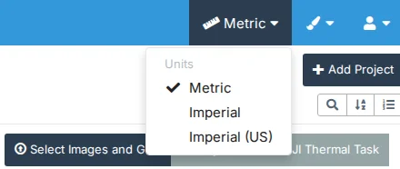
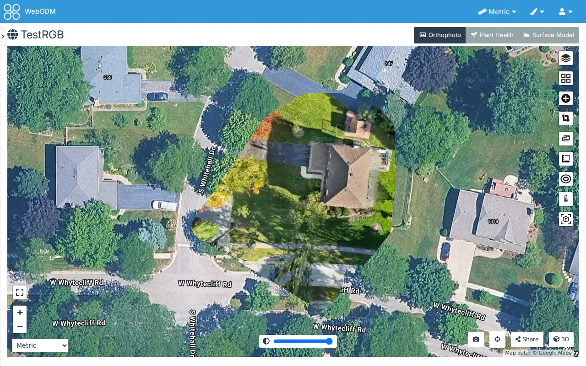
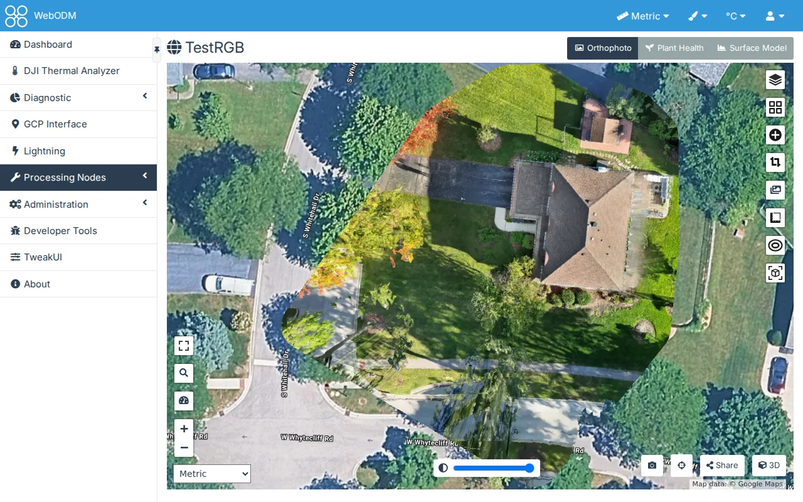
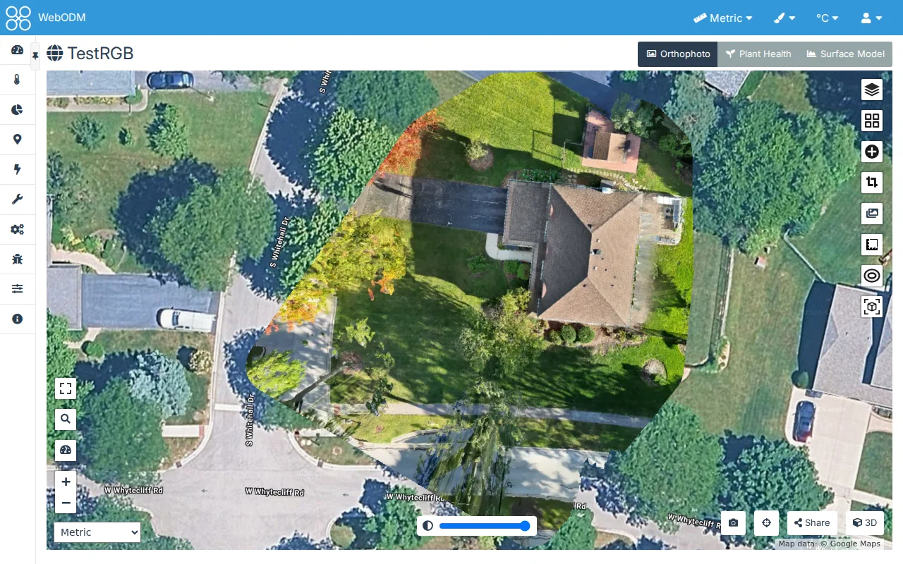
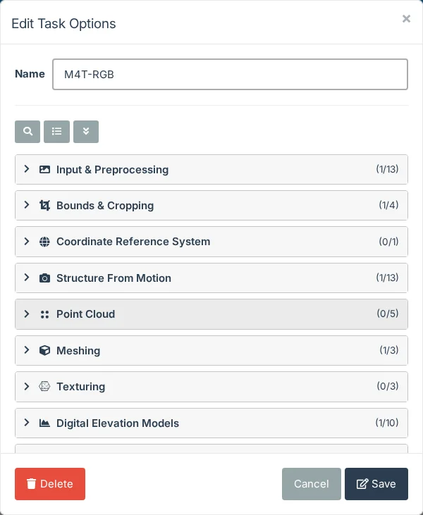
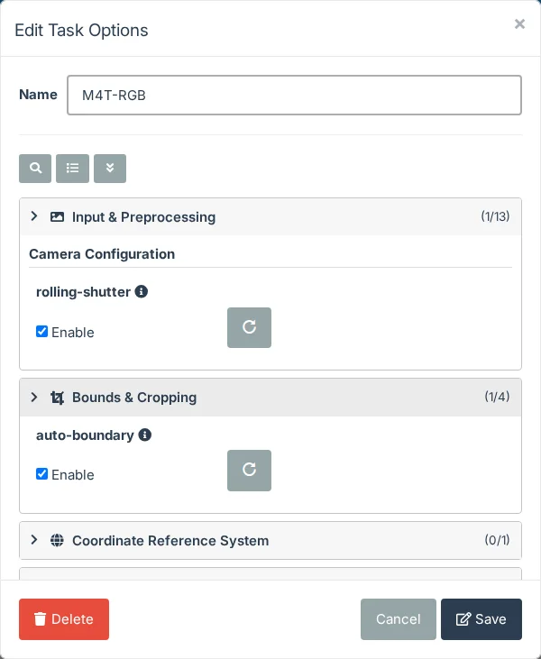
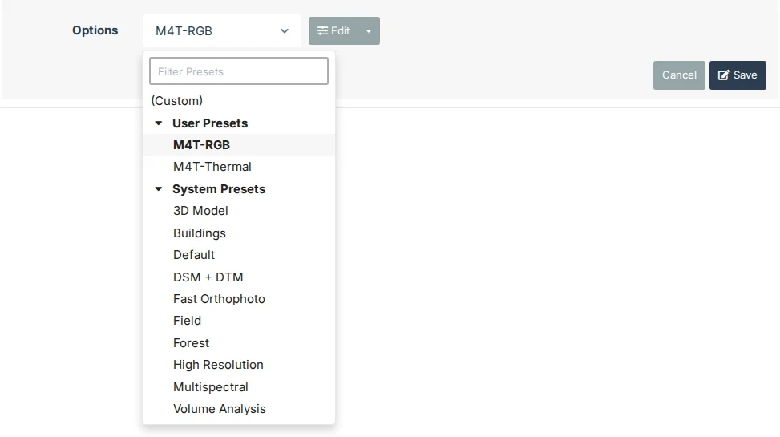
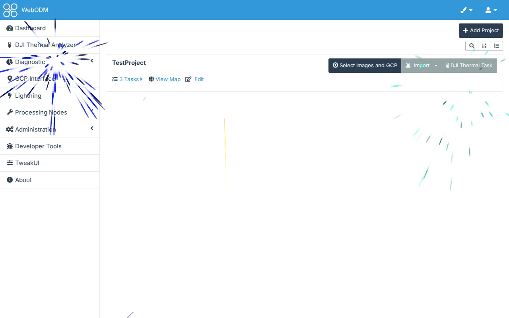

# General

## Global Controls > Units Menu

Off by default.

A units menu in the header, left of the paintbrush, sets the unit system for measurements: **Metric**, **Imperial**
or **Imperial (US)**. It's the same choice as the units selector on the 2D map and in the 3D view, so changing either
one changes the other. Like WebODM's own selector, the choice is kept in this browser, not in your account. On a phone
the menu shows only its ruler icon. WebODM's Windows app has no header, so there the menu is **Units** in the side
menu, just above TweakUI, and opens below it.

TweakUI's header menus (the units menu and the [theme menu](themes)) come first, before any other plugin's, so the
order is the same on every page: another plugin's menu, such as DJI Thermal Analyzer's °C / °F, sits between them and
the user icon. That plugin follows WebODM's units, so choosing Imperial here shows °F there, and choosing °C there
shows Metric here. On a phone with more menus than fit beside WebODM's name, the menus get narrower, and if that
isn't enough the name is left out (the logo still leads to the Dashboard).

## Navigation Pane > Collapsible Navigation Pane

Off by default.

A small tab sits on the divider between the side menu and the page, just below the header. Each click takes the side
menu one step:

1. **Icons only:** the side menu narrows to its icons, and each icon's name shows when you point at it. This is the
   same view as Resizable Navigation Pane's narrowest, and it works without that setting.
2. **Hidden:** the page takes the whole width, which gives a map or the 3D view more room, and only the tab stays, at
   the left edge.
3. **Shown:** the side menu comes back at WebODM's usual width, even if you had dragged it to another width.

The tab's tooltip names the next step. The choice is kept in this browser, so the next page opens the same
way. On a phone the side menu is already behind the header's menu button, so there's no tab. On WebODM's Windows app
the tab sits near the top of the window.

### Auto-hide

Off by default, and only with Collapsible Navigation Pane on.

The side menu stays hidden, and the page has the whole width, until the pointer reaches the window's left edge. The
side menu then shows over the page, which keeps its size, so a map or the 3D view doesn't redraw. It hides again
once the pointer has been off it for the Hide Delay, or at once with Esc. Moving back onto it in time keeps it shown.
Tabbing into the side menu with the keyboard shows it too.

It shows at the width you last dragged it to with Resizable Navigation Pane, or WebODM's usual width otherwise.

While auto-hide is on, the tab doesn't cycle through the three steps. Instead it pins the side menu open beside the
page, as without auto-hide, and a second click unpins it. The pin is kept in this browser. On a phone the side menu
stays behind the header's menu button.

**Hide Delay** sets how long the side menu waits after the pointer leaves it: from 200 to 3000 milliseconds, 500 by
default. The slider moves in steps of 100, and the box beside it takes any whole number in that range.

## Navigation Pane > Resizable Navigation Pane

Off by default.

Point at the divider between the side menu and the page: it lights up and the pointer becomes a resize arrow. Drag it
to make the side menu wider (up to half the window) or narrower. Labels too long for the width are cut off; drag it
narrower than about 120 px and it snaps to the icons alone, where each icon's name shows when you point at it.
Double-click the divider to put back WebODM's usual width. The divider also works from the keyboard: Tab to it, then
the arrow keys narrow and widen the side menu, Home gives the icons alone and End the usual width.

The width is kept in this browser. With Collapsible Navigation Pane on too, the tab sits on the divider wherever it is.
On a phone there's no divider to drag.

## Task Options > Configured Option Counts

Off by default.

In the Task Options dialog (a new task's Options > Edit, or a task's Edit), each group heading shows how many of
its options are configured (not at ODM's default), out of how many it has: "Input & Preprocessing (1/13)" once ignore-gsd is
enabled. The count follows your changes, including "Reset to default". Options a preset sets count too (the Default
preset sets auto-boundary and dsm). It works in the grouped view only, and "Other Options" is counted only while it
is open.

## Task Options > Configured Options When Collapsed

Off by default.

In the Task Options dialog, a collapsed group still shows its configured options (those not at ODM's default),
under its heading: "Structure From Motion" shows feature-quality when it is set to ultra. They're WebODM's own
controls, so you can change one there; reset it to its default and it leaves the list. Opening a group shows all its
options as usual, and closing it shows only the configured ones again. It works with or without Configured
Option Counts, which counts the same options. It works in the grouped view only, and "Other Options" shows nothing while it is closed.

The Expand/Collapse button (beside Search and the view switch) then cycles three steps: **Expand All**,
**Collapse All** (the configured options hidden too) and **Collapse All but Configured**, which is how the dialog
opens. Its tooltip names the next step. When no option is configured, the button is WebODM's usual Expand All and
Collapse All.

## Task Options > Preset Menu with Filter

Off by default.

The Options dropdown, where a new task or a task you edit picks its preset, lists its presets in an order that's
easier to scan:

- **(Custom)** at the top, when you have edited the options.
- **User Presets**: the presets you saved, A to Z. Without presets of your own, it isn't there.
- **System Presets**: WebODM's presets, Default among them, A to Z.

Both submenus start open; a click on a submenu's name closes it, and opens it again.

A **filter box** at the top of the menu has the keyboard focus as the menu opens: type part of a preset's name, in
any case, and only the presets that match stay, their submenus open ("No matching presets" when none does). Enter
chooses the first match and the down arrow moves into the list. Escape clears the filter, and a second Escape closes
the menu. The filter starts empty each time the menu opens.

The chosen preset is in bold and highlighted, in your theme's colours (WebODM's own dropdown shows the system presets
on a light background, which a dark theme makes hard to read). Choosing a preset works as it does in WebODM's dropdown,
and the Edit button beside it is unchanged. From the keyboard, the arrow keys open the list and move through it.

## Task Details > Enhanced Task Details

Off by default.

When a task is expanded on the Dashboard, its details show when it started and finished, its current step while
it runs, and three rows in place of WebODM's one-line Options. Each part has its own setting under Enhanced Task
Details (Start and End Times, Matching Preset, Option Bubbles, ODX Command, Current Processing
Stage), all on by default and greyed out while Enhanced Task Details is off. With Option Bubbles off,
WebODM's own Options line stays.

- **Started** and **Finished**, after "Created on", in your local time. WebODM keeps no start or end time, so
  they are worked out from what it has: Started is when the task was created, Finished is that plus its processing
  time ("Running" while it runs). A task is created when its upload begins, and a restart resets the processing
  time, so after a slow upload or a restart both times are off by that much.
- **Current Step**, while the task runs: the ODM stage it is in, read from the task's console every 5 seconds
  while its details are open, e.g. "Current Step (8/13): Texturing". ODM runs 13 stages (12 with
  fast-orthophoto, fewer with end-with); "Starting" before the first, "Downloading results" once ODM is done and
  WebODM fetches the results.
- **Preset**: the preset the task's options match, found as WebODM's Edit dialog finds it (the first preset with
  exactly the same options and values), or "Custom". WebODM doesn't record a task's preset, so a preset edited
  since may no longer match.
- **Options**: each option in its own bubble, with its value.
- **ODX command**: the command to run the task yourself, with a copy button:
  `docker run -ti --rm -v /my/project:/datasets/code webodm/odx --project-path /datasets` followed by the task's
  options and the three the processing node adds by itself (`--pc-ept --cog --gltf`), as the node runs it.
  Replace `/my/project` with your folder, which holds the photos in `images/`; a task's boundary is read from
  `boundary.geojson` there.
  When WebODM runs on Windows (its native build), the command is ODX's own instead:
  `run.bat --project-path C:\datasets project` followed by the same options, run in ODX's folder (`apps\ODX` in
  WebODM's install folder, e.g. `C:\WebODM\resources\app\apps\ODX`). Replace `C:\datasets` with the folder that
  holds your dataset and `project` with the dataset's folder in it, which holds the photos in `images\`.

## Task Details > Task Buttons When Minimized

Off by default.

On the Dashboard, a minimized task still shows its buttons (Download, Map, 3D Model, Report, Edit, Restart, Delete
and any other plugins add, such as Thermal dataset), without its details. The square beside a task's name, or a click
on the name, cycles three steps:

- **Buttons only**, where every task starts, shown by a caret in the square.
- **Expanded**: WebODM's whole panel, with the details.
- **Fully minimized**: just the task's row, as WebODM minimizes it.

The square's tooltip names the next step. A fully expanded task stays expanded when you reload the page in the same
tab. WebODM removes a minimized task's buttons from the page, so buttons only is really WebODM's expanded task with
its details hidden, and WebODM loads it like an expanded one (its thumbnail too). The page address lists only the
tasks you expanded fully, so a project with hundreds of tasks keeps a short address.

## Just for Fun > Surprise Me

Off by default.

Fireworks go off over every WebODM page until you turn this off. The first show starts 4 to 8 seconds after a page
opens, lasts 5 to 10 seconds, and the next follows 4 to 8 seconds after it ends. They're silent, and clicks go
through them to the page. None starts while the tab is hidden.

A **right-click** (on a Mac also **Ctrl+click**) sends a rocket that bursts where the pointer is, in place of the
browser's menu. Text fields keep
their menu, and **Shift + right-click** opens it anywhere. Dragging with the right button (the 3D view's pan) sends
none.

**Rockets on Right-click**, under Surprise Me and on by default, is what makes a right-click send a rocket. Turn it off to
leave the mouse to the browser and the page, its menu and any other right-click use included, while the fireworks
still go off. Turned off or on in the settings page, it takes effect at once.

Turning it on starts a show at once, on the settings page; turning it off ends the show going. The fireworks are
[fireworks-js](https://fireworks.js.org/) (MIT licence), which comes with TweakUI and loads only when a show starts.
