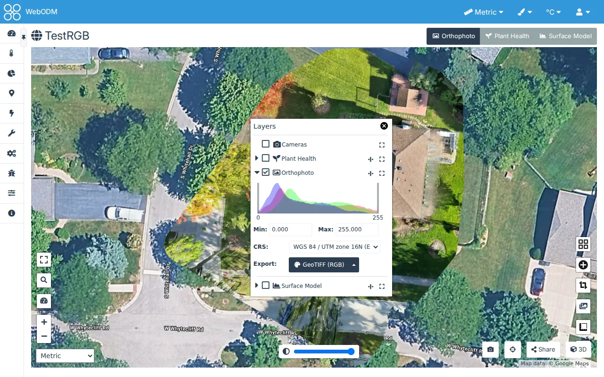
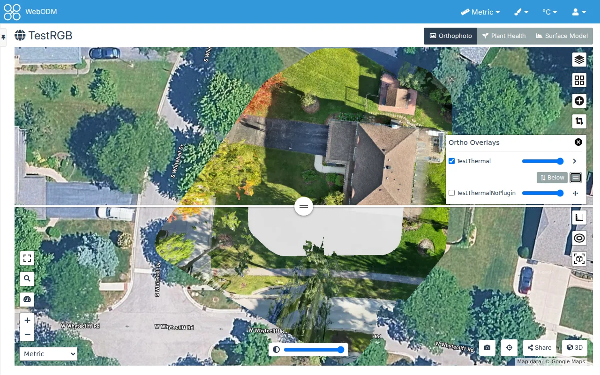
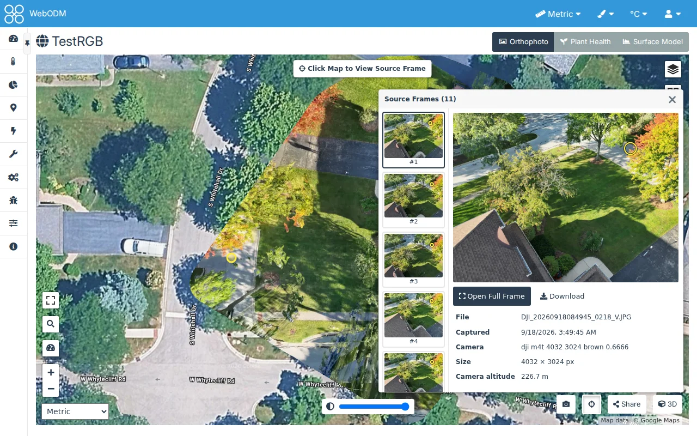
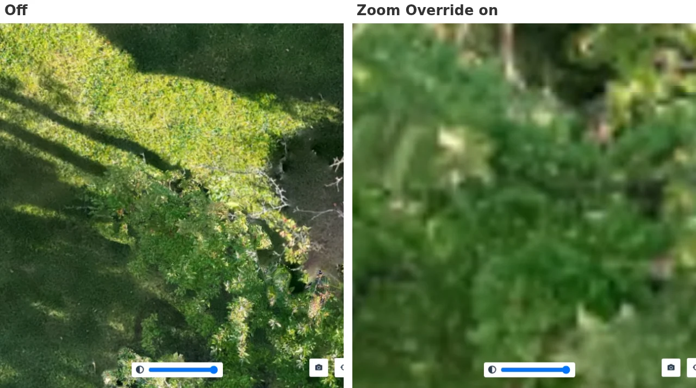
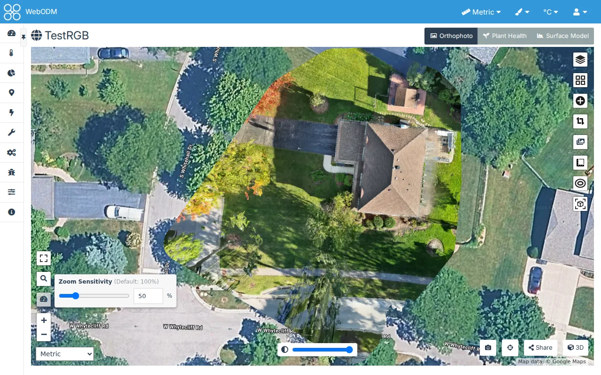
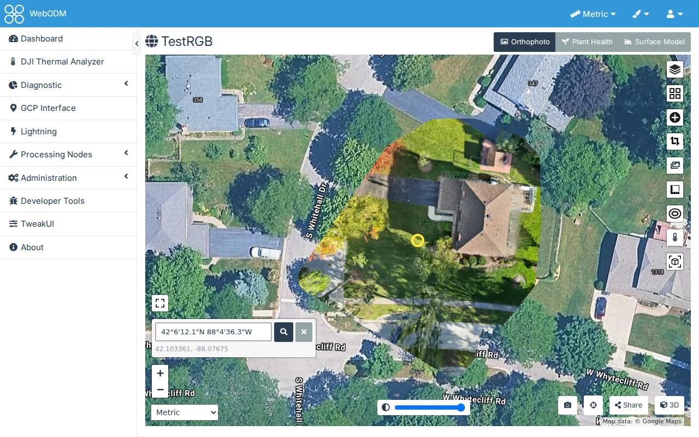

# 2D Map

## Controls > Movable Panels

Off by default.

Drag the map's panels (Layers, Base Maps, Measure, Contours, Object Detection, Other Tasks) by their title, with
the mouse or a finger, anywhere within the map. A panel that closes reopens in its usual place.

## Controls > Other Tasks' Orthophotos

Off by default.

On a task's map, a button below Layers opens an **Other Tasks** panel listing the project's other tasks that have
an orthophoto. Check one to show its orthophoto over the task's own (cropped as in its own task), and set its opacity
with the slider beside it, e.g. to compare before and after. None is shown when the map opens, and nothing is
remembered. A project's own map (Dashboard > the project's **View Map**) already lists every task's layers, so it
has no such button.

## Controls > Source Frames

Off by default.

A button beside **Share** (bottom right of the map) finds the task's photos that show a spot. Click it and the label
"Click Map to View Source Frame" shows at the top of the map while Source Frames is on. Each click on the map (a drag
still pans) moves the spot there. The first click opens a window, and each later one updates it: the photos best
first (those where the spot is nearest the middle of the frame), with the best one selected. To look over an area,
click around it.

The selected photo is shown with the spot marked on it, with its file name, capture time, camera, size and the
camera's altitude, a **Download** button, and **Open Full Frame**: the photo full screen, with zoom (wheel, pinch,
buttons, double click), pan, the previous and next photos (arrow keys), and Esc to close. It takes the keyboard focus
(on its Close button) and, closed, gives it back to Open Full Frame, of the photo you ended on. Clicking the button again,
Esc, or the window's × turns Source Frames off. A project's map searches each of its tasks with cameras.

How it finds the photos: from each photo's position, direction and lens (the task's camera shots, as WebODM shows
them in its Cameras layer) and the ground's height (the task's DSM; without one, the point cloud's mean height). A
spot counts as shown when it falls inside the photo's frame, even if something (a roof, a tree) hides it in the
photo. Only tasks with camera shots have the button.

## Controls > Deeper Zoom

Off by default.

The map zooms in 3 steps further than WebODM lets it (zoom 27 instead of 24, each step twice as close), with the
wheel, the + button and a pinch. Past the orthophoto's own detail, its pixels are enlarged.

### Zoom Sensitivity

A part of Deeper Zoom, at 100% unless you change it. Its label says "(Default: 100%)", on the settings page
and in the panel on the map, as a reminder that 100% is WebODM's own.

How far a mouse wheel notch zooms the map, from 10% to 200%: at 100% a notch zooms as in WebODM (one zoom step, or
two in Chrome on Linux and macOS, where WebODM's map counts a notch as more), at 50% half that, at 200% twice. A
trackpad's two-finger scroll and pinch follow it too, in shares of a notch. Away from 100% the map can rest between
steps, its tiles slightly scaled; the + and - buttons still zoom a whole step.

It is on the settings page (a slider in steps of 10 with a box for any whole number from 10 to 200), and on the map
itself: the gauge button at the bottom left, with the zoom buttons, opens the same slider and box. The map follows
them at once, so you can try a value while zooming, and it is saved when you let go of the slider or leave the box.
Escape or a click elsewhere closes it.

## Controls > Map Search

Off by default.

A magnifier button above the zoom buttons (bottom left of the map) opens a search box. Type in it and press Enter
(or click its magnifier); the map flies there and marks the place with a yellow ring. Close the box with its × or
Esc, which also takes the ring away. It works on a task's map and a project's map alike.

- **Coordinates** go straight there, at close zoom, with no request to any service. Latitude comes first, unless
  letters say otherwise. These all mean the same place:
  - `46.84, -91.99` or `46.84 -91.99` (decimal degrees, south and west negative)
  - `46.84 N, 91.99 W` or `N46.84 W91.99`
  - `46°50'24"N 91°59'24"W` or `46 50 24 N 91 59 24 W` (degrees, minutes and seconds)
  - `46°50.4'N 91°59.4'W` (degrees and decimal minutes)
- **Anything else** (an address, a town, a landmark) is looked up with
  [OpenStreetMap's Nominatim](https://nominatim.org/), the service WebODM already asks for a photo's place name. Up
  to five results are listed, and the map goes to the first; click another to go there instead. The map fits a
  result's area (a town, a park) or, for a single point, zooms close.

What is sent: only the text of an address search, from your browser to `nominatim.openstreetmap.org`, when you
press Enter, never as you type, and at most once a second, as
[Nominatim's usage policy](https://operations.osmfoundation.org/policies/nominatim/) asks. A search repeated in the
same visit is answered from memory. A server with no internet access can still go to coordinates.

## Speed > Tile Cache

Off by default.

WebODM draws the map's orthophoto, DSM and DTM tiles from the task's files each time they are asked for. That
includes a tile you saw a moment ago, after a reload, or one another user has just looked at. With Tile Cache on,
your map asks TweakUI for its tiles instead. TweakUI has WebODM draw each tile once, keeps it on the server, and
serves it again from there. Measured on a dev server, a kept tile comes back in about 16 ms, where drawing it takes
about 60 ms when the server is idle and several hundred ms under load.

- **Your browser keeps its own copy** and asks the server only whether it has changed (an ETag). After a reload,
  each tile is a short "not modified" answer. With [Reuse Browser Copies](#reuse-browser-copies) it doesn't ask.
- **A tile is kept per look:** the task, the layer (orthophoto, DSM, DTM, plant health), its colour map, hillshade
  and range, the crop, and whether your browser takes WebP images. Changing any of these on the map gives new tiles,
  and going back gives the kept ones. When a task is processed again, its files change and its tiles are drawn anew.
- **Who may see a tile** is WebODM's rule as always: it's checked on every request, kept tile or not. A public
  task's tiles are anyone's.
- **The tiles are shared** by everyone with Tile Cache on. The server keeps up to 1 GB of them, in WebODM's media
  folder (`plugins/tweakui/tile-cache`). Past that, the tiles used least recently go first, and so do the tiles of
  deleted tasks.
- An administrator can withhold it from users on
  [Administration > TweakUI](administration#available-to-users).

The first look at a part of the map is no faster: WebODM still draws each tile once.

### Reuse Browser Copies

A part of Tile Cache, off by default.

Without it, your browser asks the server about every tile it already has before showing it. The answer is short,
but it is still a trip to the server per tile. With it, the map asks the server once per task, when it opens, for a
version of the task's tiles, and puts it in each tile's address. Your browser then shows the tiles it has kept for
that version at once, without asking. A task processed again has a new version, so its tiles are fetched anew the
next time the map opens.

## Speed > Load Ahead, Keep More Tiles and Fade-in Speed

Three checkboxes for how the map's orthophoto, DSM and DTM layers load and show their tiles, each with a slider
beneath it. Off, each is WebODM's own behaviour; the slider, greyed out until you tick it, says how far it goes. They
work with or without Tile Cache, which makes the extra tiles cheaper for the server.

- **Load Ahead**, with **Distance** (25% to 100%, in steps of 25%; 25% when first ticked). WebODM loads only the
  tiles in view, so when you pan, the edges fill in as they come into view. Load Ahead also loads the tiles within
  that share of the view's width and height beyond each edge, so they are there before you pan to them. At 50%,
  opening a task's map on a dev server loaded 51 tiles instead of 29. At 100% it loads up to 9 times as many as
  WebODM. The tiles in view always come first: those beyond are asked for only once every tile in view has loaded
  and the map is still, and when you pan or zoom, those still loading are cancelled. So the extra tiles never hold
  up the ones you are looking at.
- **Keep More Tiles**, with **Amount** (25% to 200%, in steps of 25%; 50% when first ticked). WebODM keeps 2 rows of
  tiles beyond what it has loaded, and drops the rest as they leave. On a high-resolution screen, where WebODM uses
  tiles half the size, that is only a few hundred pixels, so panning back shows blank tiles while they load again.
  Keep More Tiles adds rows to cover that share of the view's larger side: on a 1400 px wide view with 512 px tiles,
  100% keeps 5 rows and 200% keeps 8. Kept tiles use your browser's memory.
- **Fade-in Speed**, with **Duration** (0, 50, 100, 200, 300 or 400 ms; 0 when first ticked). How long a tile takes
  to fade in once it arrives. 200 ms is WebODM's own; 0 shows each tile the moment it arrives, and 300 or 400 fade it
  in more gently. It doesn't load anything faster or slower, only changes how soon a tile appears.

## Speed > Fewer Tile Requests

Off by default.

While zooming (a pinch, the wheel, or the map flying to a place), the map's orthophoto, DSM and DTM layers ask for
tiles once the zoom ends, not for each zoom level they pass on the way. The server draws fewer tiles, which helps
most on a phone or a high-resolution screen, where every view needs about three times as many.

It can also help on a slow or unreliable connection to the server: the tiles of the levels a zoom passes through are
never asked for, so the connection carries only the tiles of the view you stop at.
