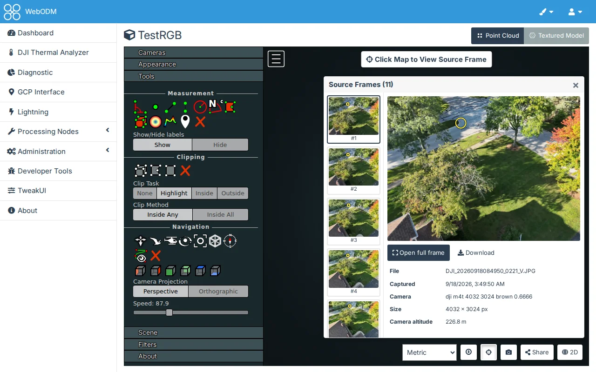
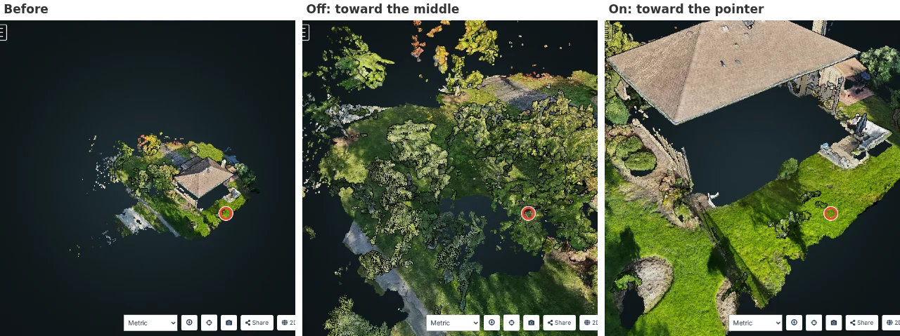

# 3D Map

## Controls > Source Frames

Off by default.

The same as [Source Frames on the 2D map](./map-2d#controls-source-frames), in a task's 3D view, by clicking the
point cloud or the textured model (a drag still turns the view; a click on empty space shows a hint). The heights
of the clicked points are used, not the DSM.

## Controls > Zoom Override

Off by default.

The mouse wheel zooms toward what is under the pointer (the point cloud or the textured model) instead of the
middle of the view, and the view then turns around that depth, so you can get as close to any surface as you want.
WebODM's 3D view has no zoom limit as such, but its wheel slows down as it nears the middle of the view and never
passes it. Over empty space, in Potree's other navigation modes and with a pinch on a touch screen, zooming is as
before.
