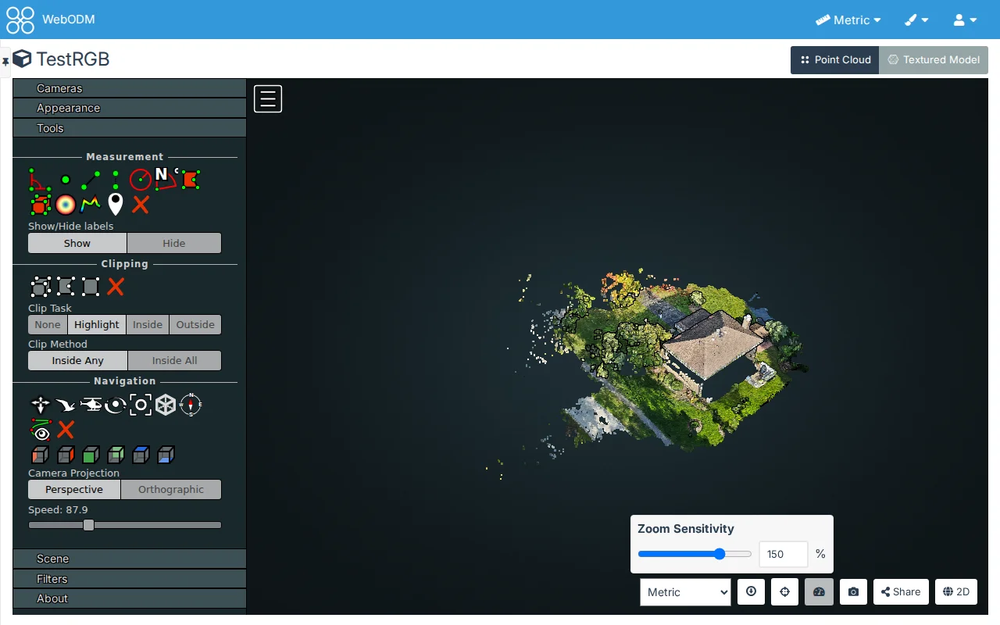

# 3D Map

## Controls > Source Frames

Off by default.

The same as [Source Frames on the 2D map](./map-2d#controls-source-frames), in a task's 3D view, by clicking the
point cloud or the textured model (a drag still turns the view; a click on empty space shows a hint). The heights
of the clicked points are used, not the DSM.

## Controls > Zoom Override

Off by default.

The mouse wheel zooms toward what is under the pointer (the point cloud or the textured model) instead of the
middle of the view, and the view then turns around that depth, so you can get as close to any surface as you want.
WebODM's 3D view has no zoom limit as such, but its wheel slows down as it nears the middle of the view and never
passes it. Over empty space, in Potree's other navigation modes and with a pinch on a touch screen, zooming is as
before.

A two-finger scroll on a trackpad zooms as far as it scrolls. WebODM's 3D view counts each of a trackpad's many
small scroll steps as a whole wheel notch, which zooms far too fast; with Zoom Override, a mouse notch still zooms
as before.

### Zoom Sensitivity

A part of Zoom Override, at 100% unless you change it.

How far a mouse wheel notch zooms toward what is under the pointer, from 10% to 200%: at 100% a notch goes a tenth
of the way, at 50% half that, at 200% twice. A trackpad's two-finger scroll follows it too. Over empty space the
wheel is WebODM's, whatever the sensitivity.

It is on the settings page (a slider in steps of 10 with a box for any whole number from 10 to 200), and in the 3D
view: the gauge button beside Share opens the same slider and box. The view follows them at once, and the value is
saved when you let go of the slider or leave the box. Escape or a click elsewhere closes it.
