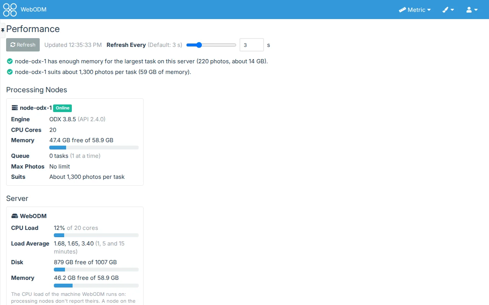
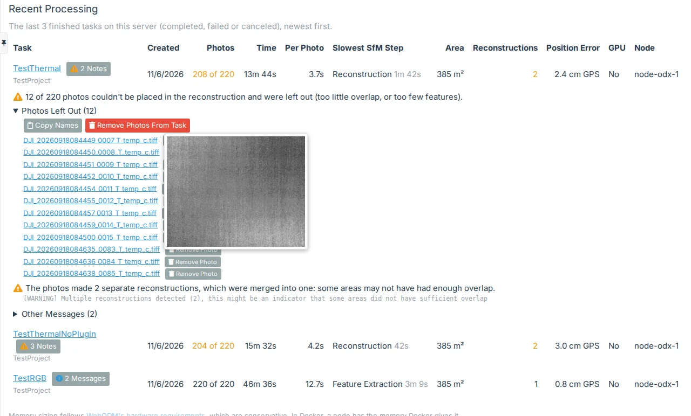

# Performance

## Performance View > Show Performance View

Off by default. Found in TweakUI's settings under **Diagnostic**, beside Show Storage View. A superuser can
withhold it from users in [Administration > TweakUI](administration).

The **Diagnostic** item in the side menu gets a **Performance** sub-item, after **System** (WebODM's own Diagnostic
page) and **Storage** if that is on too. If an administrator has turned the Diagnostic plugin off, the **TweakUI**
item gets it instead. The page is asked afresh each time it opens, and again with **Refresh**. While it is open, the
CPU load, the disks' activity and the memory refresh by themselves (see [Refresh Every](#refresh-every)), and the
free disk space every 10 seconds.

At the top are sentences on what the figures mean: whether a processing node has enough memory for your largest
task, about how many photos per task each node suits, tasks waiting on a node that processes only so many at a time,
a node that is not answering, and a server under WebODM's recommended 100 GB of free disk or 16 GB of memory.

## Processing Nodes

A card for each processing node you may use (the ones WebODM can choose for your tasks), with what the node says of
itself: its engine and version, CPU cores, memory (free of total, with a bar), its queue and how many tasks it
processes at a time, the most photos it accepts, and about how many photos per task its memory suits. A node that
doesn't answer within 3 seconds is marked **Not Answering**, with when WebODM last saw it.

"Suits about N photos" reads WebODM's
[hardware requirements](https://docs.webodm.org/installation/#hardware-requirements), which give memory by number
of photos (250 photos, 16 GB; 1,500 photos, 64 GB; 5,000 photos, 256 GB), between their rows. They are conservative:
options such as a higher resolution need more, and swap can make up some of it, slowly. In Docker a node has the
memory Docker gives it, which on Windows and macOS is Docker's own memory setting, not the computer's.

There is no GPU line: a node doesn't say whether it has a GPU. [Recent Processing](#recent-processing) shows whether
each task used one, from its log.

## Server

The CPU load of the machine WebODM's server runs on, the disk WebODM keeps its tasks on (free of total) and the
server's memory, as WebODM's own **System** page shows them.

**CPU Load** is the share of time the processors were busy since the last refresh, as top and htop show it: the
total across all cores in one bar (100% is every core busy), with how many cores there are, and, on Linux and in
Docker, the load averages over 1, 5 and 15 minutes (the number of processes running or waiting, to compare with the
number of cores). Windows keeps no load average, so WebODM's Windows app shows the total without it. The first
figures show a second after the page opens: a load is the difference between two readings.

No processing node reports its own CPU load (a node's info has its cores and memory only), so this is the server's
machine. When the node runs on the same machine, as in WebODM's usual install and its Windows app, that is the
node's load too; a node on another machine is not measured. In Docker the figures are the computer's (on Windows and
macOS, Docker's own virtual machine's), the same that the containers share.

### Disk Activity

Beside the server's card, a card for each disk WebODM's server uses, named as the system names it (`sde`, or a drive
letter such as `C:` in WebODM's Windows app), with where it is mounted. The disk that holds the tasks comes first,
marked **Tasks**. Since the last refresh, each shows:

- **Reads** and **Writes**: operations per second, bytes per second, and the average size of one.
- **Busy**: the share of time the disk was working, with a bar that turns to a warning colour past 80% and to danger
  past 95%. A disk that is always busy holds the processing up.
- **Wait**: the average time an operation took, waiting included.

The system's counters don't tell random from sequential work. The size of one operation hints at it: small ones (a
few KB) are scattered, random work, and large ones (hundreds of KB and up) are sequential. Nothing is written to the
disk to measure it: the figures are the system's own counters, read as they are.

The counters are for each whole disk, whatever uses it. In Docker they are the disks of the machine Docker runs on (on
Windows and macOS, Docker's own virtual machine's), so the processing node's and the worker's work on the same disk
counts too.

### Refresh Every

A part of Show Performance View, 3 seconds unless you change it. How often the page refreshes the CPU load, the
disks' activity, the server's memory and each node's memory, from 1 to 10 seconds. It is on the settings page and at the top of the
Performance page, beside **Refresh** (a slider and a box, as for the other number settings); a change there applies at
once and is saved when you let go of the slider or leave the box. The free disk space refreshes every 10 seconds. Nothing is
refreshed while the browser tab is hidden, and a refresh waits for the last to be answered.

## Recent Processing

Your last 10 finished tasks, newest first: completed, failed or canceled. A failed task says so under its name, with
WebODM's error, and its notes open; a canceled one says **Canceled**. Each task has:

- **Photos**: the photos placed in the reconstruction of those given ("208 of 220"), from the task's report
  (`odm_report/stats.json`); in the warning colour when some were left out. Just the photos when there is no report.
- **Time** and **Per Photo**: its processing time, and that time per photo (completed tasks only).
- **Slowest SfM Step**: the slowest of the structure-from-motion steps ODM times in its report (feature extraction,
  matching, reconstruction...; the later steps are not timed one by one).
- **Area**: the area the photos cover.
- **Reconstructions**: how many separate reconstructions the photos made before ODM merged them, in the warning colour
  above one, a sign that some areas did not overlap enough. It comes from the log, since the report counts the merged
  one.
- **Position Error**: the reconstruction's average distance from the photos' GPS positions, or from the ground
  control points (**GCP**) when the task had them.
- **GPU**: whether the node used a GPU, from the log (**No** when it found none).
- **Node**: the node that processed it.

Area and Position Error are in WebODM's unit system, the one the maps' unit selector and
[Units in Header](general#global-controls-units-in-header) set: square metres or hectares and centimetres or metres in metric, square
feet or acres and inches or feet in imperial. They change with it. At phone width these columns, the date, the step and
the node fold into a line under the task's name.

Administrators see the last 10 on the server, whoever they belong to, and the largest task anyone has run.

### Notes from the Log

TweakUI reads each listed task's log (what the processing node printed, as on the task's panel) for the messages
worth knowing, and a **Notes** button by the task's name opens them, each in a plain sentence with the line it came
from:

- Out of memory: processing stopped (or a step was run again with less memory, a sign the node is short of it).
- Stopped on strange values in the reconstruction, not enough usable photos, a problem with the GCP file, a CPU too
  old for ODX or a program missing on the node.
- Photos left out of the reconstruction, photos with no features found, separate reconstructions merged.
- Photos without a GPS position or with an altitude of zero, ground control points not used, GCP lines naming photos
  the task hasn't, multispectral bands with photos missing.
- The GPU failed and the CPU finished the point cloud.

When photos were left out of a completed task, **Photos Left Out** under that note lists them by name: the task's
photos (WebODM keeps them with the task) that its report's camera positions (`shots.geojson`) don't name, with the
log's reason beside a name when it gives one (No features, No GPS). Each name opens the photo in a new tab (2048
pixels on its longest side, through WebODM's thumbnail of it), and hovering or focusing a name shows a small
thumbnail. **Copy Names** puts the names on the clipboard, one per line, to find them among your files. Up to 500 are
listed, the rest counted.

Below them, **Other Messages** opens every other warning and error line in the log, once each with how many times it
came (GDAL's `CPLE_AppDefined` warnings, one per texture, are left out). A huge log is read only at its start and end
(its first and last 8 MB), and a finished task's log only once.

With 4 or more completed tasks to compare, a line says whether the newer half took more or less time per photo than the
older half (by their medians), or about the same (within 10%). Photos and options differ from task to task, so take it
as a hint, not a measurement.

TweakUI only reads: it asks each node for its info, reads the server's CPU counters and each task's report and log,
and changes nothing.
