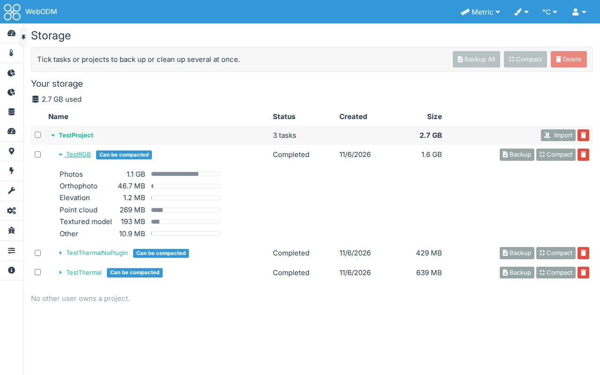

# Storage

## Storage View > Show Storage View

Off by default. Found in TweakUI's settings under **Diagnostic**, beside Show Performance View. A superuser can
withhold it from users in [Administration > TweakUI](administration).

The **Diagnostic** item in the side menu gets two sub-items: **System** (WebODM's own Diagnostic page) and
**Storage** (and [**Performance**](performance) when that is on too). If an administrator has turned the Diagnostic
plugin off, the **TweakUI** item gets **Settings** and **Storage** instead, already expanded.

The Storage page shows how much of your quota is used ("X of Y used", or "X used" without a quota) and the projects
you own, largest first. A project opens to its tasks (status, date, size), with failed, canceled and compactable
tasks marked; a task opens to its files by kind: photos, orthophoto, elevation, point cloud, textured model and
other files. Projects shared with you are not listed: they count toward their owner's quota, not yours.

## Cleaning up

Use a row's own **Compact** or **Delete**, or select one or multiple tasks and projects with their checkboxes and use
the bar's **Compact** or **Delete** (selecting a project includes all its tasks). Before anything is done, a confirmation lists what will be
removed and how much space it frees. Compact deletes a completed task's photos and keeps its maps and models (the task
can no longer be restarted). The work is done by WebODM itself, as from the Dashboard, with its own permissions and
quota.

## Backup and Import

A completed task's **Backup** downloads the whole task as a zip: WebODM's own backup, the same file as the
**Backup** item of the task's **Download** menu, with its photos, results, options and name. Select one or
multiple tasks or projects and use the bar's **Backup All** to download one zip for each completed task among them, one after another
(the browser may ask once to allow several downloads); tasks that are not completed are skipped, and the status line
says how many.

A project's **Import** adds tasks to it from zips: choose one or more, and each is uploaded (its progress shown) and
becomes a task of that project. A backup comes back as the task it was, with its name, options and dates; a zip of a
task's assets imports as WebODM's **Import** makes it. The task is marked **Importing** while WebODM unpacks it. Either
kind of zip can also go through WebODM's own **Import** on the Dashboard.

Administrators also see every other user who owns a project, with their quota and projects, and can clean them up
the same way. TweakUI only reads the task folders, to measure them. It never deletes files itself, so leftover
folders, caches and the processing nodes' copies are beyond its reach.
