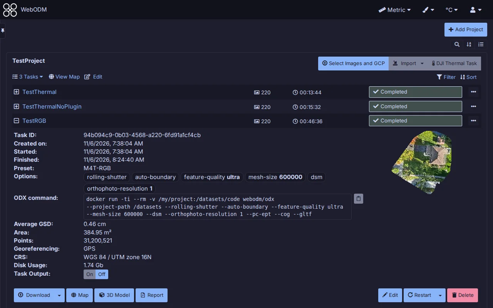
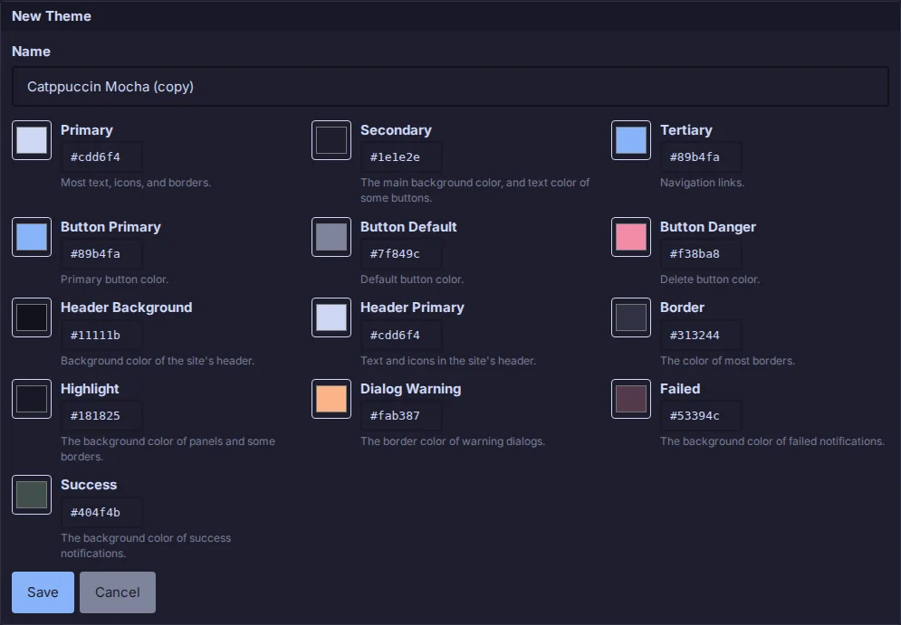
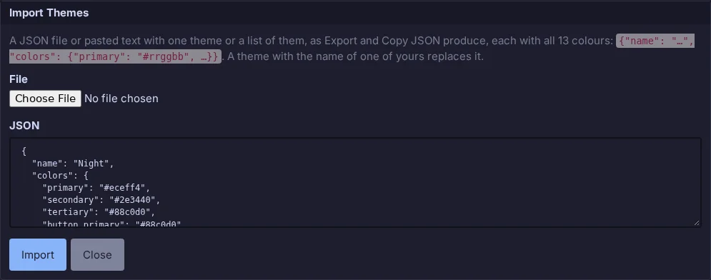
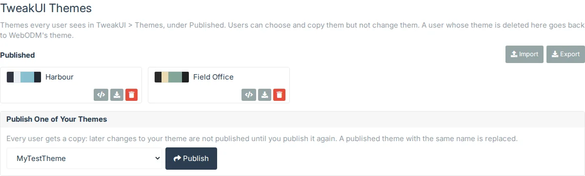
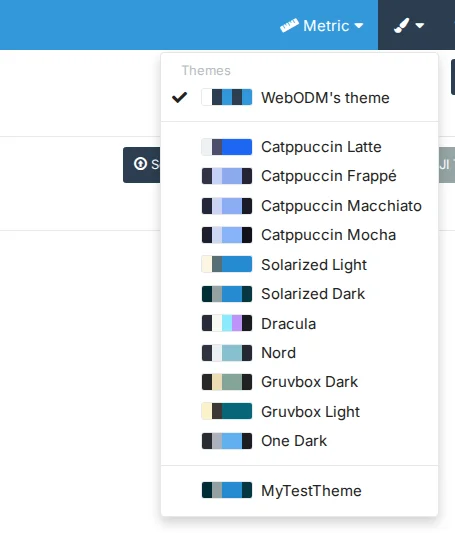

# Themes



Choose the colours WebODM shows you (nobody else sees your choice): **WebODM's theme** (the default, whatever the
administrator set in Administration > Theme) or one of 11 presets: Catppuccin Latte, Frappé, Macchiato and Mocha;
Solarized Light and Dark; Dracula; Nord; Gruvbox Dark and Light; One Dark. Each shows a swatch of its colours;
choosing one reloads the page in it.

## My Themes



Your own themes, listed under **My Themes** below the presets, for you only. **New Theme**, below the heading,
starts one from your current theme's colours, and **Copy** beside any theme (WebODM's, a preset or one of your own)
starts one from that theme's. Only your own themes have **Edit**: WebODM's theme, the presets and published themes
can be copied but not changed.

The editor opens below the themes, with a name and the 13 colours of WebODM's theme, named and described as in
Administration > Theme. Each colour has a picker and its value as `#rrggbb`, which you can also type (the `#` is
optional). While the editor is open, the whole page, the Sample included, previews the colours before you save.
**Save** keeps the theme and makes it your theme; **Cancel** puts the page back in your theme; **Delete** (when
editing) deletes the theme, after asking. If you delete the theme you're using, you're back on WebODM's theme.

A theme needs a name of up to 60 characters, and you can have up to 50. Your themes are also in the header's theme
menu, after the presets and the published themes.

## Import and export



Themes move between users and WebODMs as JSON: one theme is an object with its name and all 13 colours, as in
Administration > Theme, and a file can hold one theme or a list of them.

```json
{"name": "Night", "colors": {"primary": "#eceff4", "secondary": "#2e3440", "tertiary": "#88c0d0",
  "button_primary": "#88c0d0", "button_default": "#4c566a", "button_danger": "#bf616a",
  "header_background": "#242933", "header_primary": "#eceff4", "border": "#434c5e", "highlight": "#3b4252",
  "dialog_warning": "#d08770", "failed": "#523f4a", "success": "#4b5653"}}
```

- **Export**, beside New Theme, downloads all your themes as `tweakui-themes.json`; the download button on one of
  your themes downloads just it.
- **Copy JSON** beside any theme (WebODM's, a preset or your own) puts it on the clipboard, to paste into a
  message or another WebODM's Import.
- **Import** opens a panel: choose a file (its text shows in the box) or paste JSON, then click **Import**. A theme
  with the same name as one of yours replaces its colours (if it's your current theme, you keep using it); the others
  are added.
  The panel says what was added, replaced and refused, and why (a colour that isn't `#rrggbb`, a missing colour,
  no name, more than 50 themes). **Close** then reloads the page to list them.

## Published themes



Themes an administrator gives every user. They're listed under **Published**, between the presets and My Themes,
when there are any. Everyone can choose one, **Copy** it into a theme of their own or **Copy JSON**, but only a
superuser can change the list. If a published theme you're using is deleted, you're back on WebODM's theme.

Superusers manage them in **Administration > TweakUI Themes**, a link TweakUI adds after Administration > Theme in
the side menu (other staff don't see it, and the page and its API refuse them):

- **Publish One of Your Themes**: choose one of your own themes (make it in Settings > Themes > My Themes) and
  **Publish**. Every user gets a copy, so later changes to your theme aren't published until you publish it again. A
  published theme with the same name is replaced, and users who chose it keep it.
- **Import** adds a file or pasted JSON to the published themes, as under [Import and export](#import-and-export).
  A theme with the same name as a published one replaces it.
- **Export** downloads all the published themes as `tweakui-published-themes.json`; each theme's download button
  downloads just it, and **Copy JSON** puts it on the clipboard.
- **Delete** deletes a published theme, after asking.

There can be up to 50 published themes.

## Sample Form for Viewing Theme Effects

Below the themes, a framed **Sample Form for Viewing Theme Effects** shows WebODM's controls in the current theme:
text, a link and muted text, status labels, a progress bar, a text field, a select, a dropdown menu, buttons (one
with a tooltip, one disabled) and page numbers. They do nothing: they show how the theme looks on controls the
settings page doesn't otherwise have.

A preset fills the colours of WebODM's own theme, so it changes exactly what an administrator's theme can change,
in each WebODM version. Places WebODM always shows in white keep their white background (some icons and controls
there only work on white) with readable text: the map's layers panel, the Contours and Object Detection panels,
and the content of Administration, which keeps WebODM's own theme. Light presets have a header in their accent
colour, as WebODM's logo is white. Dropdown menus show their items in the preset's text colour (WebODM fixes them
to near-black, which a dark preset's menu background would hide).

## Theme Menu > Show Theme Menu

On by default.



The **paintbrush** in the header, left of the user icon, changes the theme from any page. It lists your current
theme and WebODM's theme first, then the presets, the published themes and your own; choosing one switches to it.
This setting, at the top of Themes, turns it off. WebODM's Windows app has no header, so there it is **Theme** in
the side menu, just above TweakUI, and opens below it.
